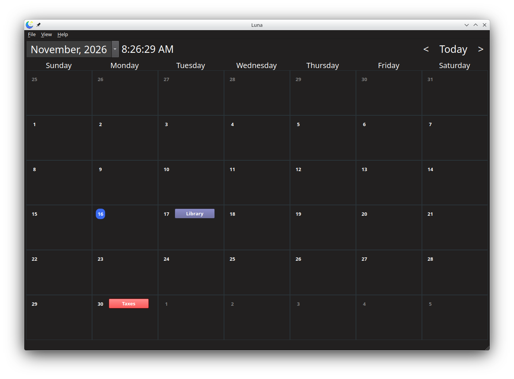

# Luna

Repurpose old touchscreens with an elegant and interactive calendar.

Qt LTS is required.

Dates are recorded in ISO 8601 format.

<b>Version 2026.11.30 is the newest LTS release.</b>

<b>Release Notes</b>

<b>2026.11.30 Release</b>

<ul>
<li>Close an event editor if the event is removed via a context menu.</li>
<li>Inspect items and widgets in luna_day_widget::prepare_fonts().</li>
<li>Remove existing event widgets in luna_day_widget::set_date().</li>
</ul>

<b>2026.11.16 Release</b>

<ul>
<li>New grid color.</li>
<li>Removed bold font from day labels.</li>
<li>Show as maximized.</li>
</ul>

<b>2026.10.17 Release</b>

<ul>
<li>Resize an Event dialog if child widgets are hidden.</li>
</ul>

<b>2026.08.15 Release</b>

<ul>
<li>First release.</li>
</ul>

